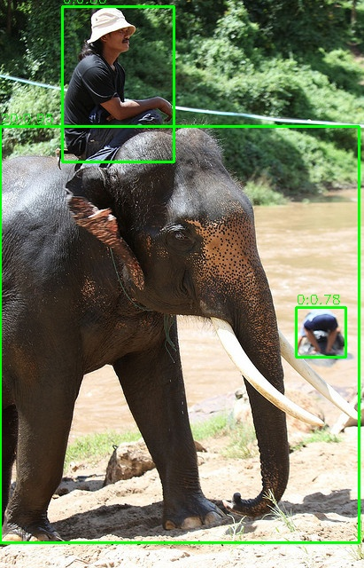

# RDK 模型转换、推理与多线程服务工程

本仓库面向地瓜机器人 RDK 平台，提供一套从训练模型导出、板端模型转换、单机推理验证到多线程服务化推理和性能优化的工程化样例。当前主线聚焦于 YOLO 类检测模型，覆盖 `PT -> ONNX -> BIN -> RDK 端侧推理 -> 多通道服务化运行` 的完整流程。

## 项目概览

仓库主要分为四条工作链路：

- **模型转换**：将训练得到的 `*.pt` 模型导出为 `*.onnx`，再进一步转换为 RDK 侧可部署的 `*.bin`
- **模型推理**：基于 RDK DNN Runtime 与 OpenCV，完成模型加载、预处理、推理执行、后处理与结果可视化
- **多线程服务化推理**：基于共享内存、Unix Domain Socket 和多 worker 并发调度，完成多路输入的批次下发、推理聚合与结果回传
- **性能优化 skill**：基于 `skills/` 与 `scripts/perf/` 提供可复用的性能优化工作流，用于本地构建、板端运行、日志回收和瓶颈迭代分析

## 整体流程

```text
Ultralytics *.pt
    -> model_convert/pt2onnx
ONNX 浮点模型
    -> model_convert/onnx2bin
RDK *.bin 模型
    -> model_infer
单机端侧检测结果 / 可视化输出
    -> multi_thread_proj
多通道服务化推理与聚合结果
    -> skills + scripts/perf
性能优化与日志分析闭环
```

## 目录结构

```text
.     
|-- model_convert/          # 模型转换链路
|   |-- pt2onnx/            # PT 导出 ONNX
|   `-- onnx2bin/           # ONNX 转 RDK BIN
|-- model_infer/            # 端侧推理链路
|   |-- model_inference_base/
|   |-- yolo_infer/
|   |-- test/
|   `-- asset/
|-- multi_thread_proj/      # 多线程服务化推理工程
|-- skills/                 # 自建 Codex skills
|-- scripts/                # skill 依赖的项目适配脚本
|-- perf/                   # 底层构建/板端执行/拉日志脚本
`-- 3rdlibrary/             # DNN/OpenCV 等第三方依赖
```

## 快速开始

### 1. 模型转换

模型转换入口位于 [model_convert/README.md](/Users/xurongtang/workerFolder/RDK_resource/RDK_proj/model_convert/README.md)。

典型流程为：

1. 在训练环境中将 `*.pt` 导出为 `*.onnx`
2. 在 OpenExplorer Docker 或对应 Python 环境中将 `*.onnx` 转为 `*.bin`
3. 生成供板端推理使用的量化模型与转换日志

### 2. 端侧推理

推理入口位于 [model_infer/README.md](/Users/xurongtang/workerFolder/RDK_resource/RDK_proj/model_infer/README.md)。

典型流程为：

1. 使用交叉编译工具链构建 `model_infer`
2. 将可执行程序、模型文件和依赖库部署到 RDK 板端
3. 运行测试程序并输出检测结果与可视化图片

### 3. 多线程服务化推理

`multi_thread_proj/` 在 `model_infer` 的单模型推理能力之上，提供面向多路输入的服务化封装：

1. `mt_manager` 负责扫描多路输入目录、准备批次数据，并通过共享内存投递图像负载
2. `mt_server` 负责接收批次通知、按通道分发给 worker 执行推理，并聚合每个通道的检测结果
3. 管理端与服务端通过 Unix Domain Socket 传递控制消息，通过共享内存传递图像数据，减少重复拷贝

典型构建方式：

```bash
cd multi_thread_proj
./build.sh
```

构建产物默认输出到 `multi_thread_proj/build_aarch64/`，包括 `mt_server`、`mt_manager` 以及对应测试程序。

### 4. 自建性能优化 skill

如果希望把“本地构建 -> 板端部署 -> 远程运行 -> 日志拉回 -> 瓶颈分析”做成固定工作流，可以直接使用仓库内的自建 skill。接入说明见 [skills/README.md](/Users/xurongtang/workerFolder/RDK_resource/RDK_proj/skills/README.md)。

## 结果展示

以下示例展示了仓库当前推理流程的输入图像与输出结果：

### 输入图像


### 推理结果



## 依赖与环境

### 模型转换侧

- Python 3
- Ultralytics / PyTorch
- ONNX Runtime
- OpenCV Python
- `hb_mapper`

### 推理侧

- `aarch64-linux-gnu-gcc` / `aarch64-linux-gnu-g++`
- RDK DNN SDK
- OpenCV aarch64 安装包
- RDK 板端运行环境

## 子模块说明

- [model_convert/README.md](/Users/xurongtang/workerFolder/RDK_resource/RDK_proj/model_convert/README.md)：介绍模型导出与模型转换的职责、输入输出和使用流程
- [model_infer/README.md](/Users/xurongtang/workerFolder/RDK_resource/RDK_proj/model_infer/README.md)：介绍交叉编译、板端运行和推理接口
- [multi_thread_proj/README.md](/Users/xurongtang/workerFolder/RDK_resource/RDK_proj/multi_thread_proj/README.md)：封装多路输入、多 worker 推理和结果聚合的服务化执行链路
- [skills/README.md](/Users/xurongtang/workerFolder/RDK_resource/RDK_proj/skills/README.md)：介绍自建 skill 的目录结构、适配脚本契约，以及接入到其他工程的方法

## 说明

本仓库当前文档重点覆盖模型转换、端侧推理、多线程服务化推理与性能优化工作流。若需要查看底层推理封装，可继续阅读 [model_infer/model_inference_base/README.md](/Users/xurongtang/workerFolder/RDK_resource/RDK_proj/model_infer/model_inference_base/README.md)。
